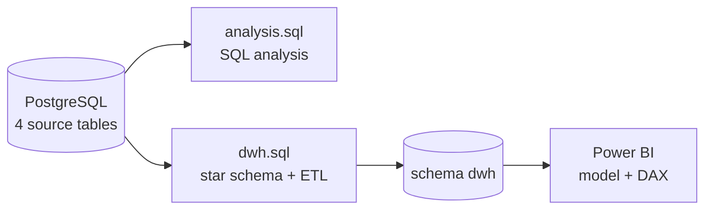
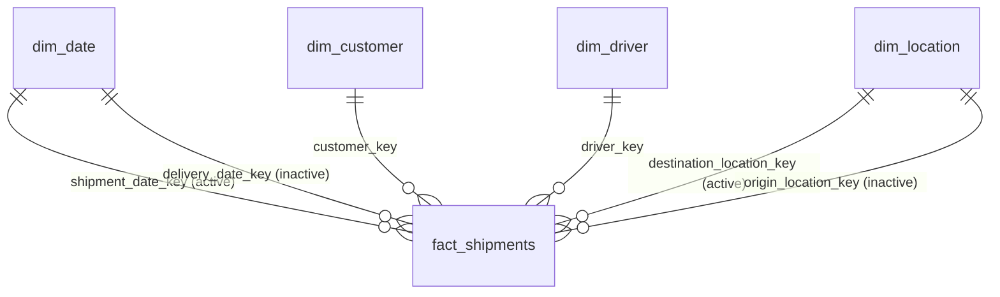

# Logistics Shipment Analytics

End-to-end analytics project for a fictional logistics company: **PostgreSQL** analysis queries, a **star-schema data warehouse** built with SQL ETL, and a two-page **Power BI** dashboard for shipment operations and cost.

> **Dashboard:** [View the Power BI report](https://app.powerbi.com/groups/me/reports/54a76236-fb5e-4e61-a6d9-bdcf358b913a/1f8ac2717931b1acd974?experience=power-bi)

| | |
|---|---|
| **Database** | PostgreSQL 12+ |
| **Modeling** | Star schema (1 fact, 4 dimensions), idempotent ETL |
| **BI** | Power BI Desktop, DAX |
| **Data** | Fully synthetic (generated with SQL, seeded) |

---

## Dashboard preview

| Operational Overview | Cost Analysis |
|---|---|
|  |  |

**Operational Overview** – shipment volume by status per month, on-time rate, average delivery time, and shipments by destination city.
**Cost Analysis** – monthly cost trend, cost split by component (fuel / labor / toll), and the 10 most expensive shipments with delayed ones highlighted.

---

## Project flow



## Repository structure

```
.
├── schema_and_data.sql   # creates the 4 source tables + synthetic data
├── analysis.sql          # SQL analysis (basic → advanced)
├── dwh.sql               # star schema DDL + ETL + validation checks
├── docs/                 # dashboard screenshots
└── README.md
```

Run order: `schema_and_data.sql` → `analysis.sql` (independent) → `dwh.sql` → connect Power BI to schema `dwh`.

---

## 1. Source data model

Four operational tables, designed with explicit constraints so bad data cannot get in:

| Table | Role | Key points |
|---|---|---|
| `customers` | Who ships | PK `customer_id`; city + region |
| `shipments` | One row per shipment | FK → customers; `delivery_date` nullable |
| `shipment_costs` | Cost per shipment | 1:1 with shipments; `total_cost` is a **generated column** (fuel + labor + toll) |
| `drivers` | Driver ↔ shipment assignment | PK `(driver_id, shipment_id)`, `shipment_id` unique |

### Decisions on the source schema

| Decision | Why |
|---|---|
| `delivery_date >= shipment_date` (CHECK) | A shipment cannot arrive before it leaves. |
| `delivery_date` is NULL for *In Transit* and *Cancelled*, NOT NULL for *Delivered* and *Delayed* (CHECK) | Date and status must agree; otherwise delivery-time metrics silently become wrong. *Delayed* is modelled as "arrived late". |
| `total_cost` as `GENERATED ALWAYS … STORED` | It can never disagree with its three components. |
| `drivers` uses a composite PK | A driver is assigned to many shipments, so `driver_id` alone cannot be the PK. Treating the table as an *assignment* table makes "shipments per driver" answerable. `UNIQUE(shipment_id)` keeps one driver per shipment. |
| Cancelled shipments have no cost row and some have no driver | Realistic: they were cancelled before dispatch. Downstream queries therefore use `LEFT JOIN` or filter them explicitly. |
| Shipment dates capped to 31 Dec 2024 | Keeps every date inside the date dimension. |

### Synthetic data
480 shipments across 12 Indonesian cities, 60 customers, 20 drivers, Jan–Dec 2024. Cost is driven by weight, status (delayed ≈ +25 %) and season (Nov–Dec ≈ +20 %), so the trend analysis has a pattern to find. `setseed()` makes the generator repeatable on the same PostgreSQL setup; the generated values should be treated as a sample, not as real business figures.

---

## 2. SQL analysis (`analysis.sql`)

Conventions used throughout:
- **Month** always comes from `shipment_date` (when the cost is incurred), never `delivery_date`.
- **Cancelled** shipments are excluded from cost and weight metrics (nothing moved, no cost row) but **included** in driver reliability (a cancellation is a failure).
- **Region** of a customer = `customers.region`.

### Basic (1A)

| # | Question | Approach & decision |
|---|---|---|
| 1 | Delayed / cancelled shipments in Q3 2024 | Date range written as `>= 1 Jul AND < 1 Oct` – safe even if the column later becomes a timestamp. |
| 2 | Total cost per region (2024), regions with > 5 shipments | `HAVING COUNT(*) > 5` because the condition is on an aggregate. `LEFT JOIN` costs so a missing cost row never drops a shipment from the count. |
| 3 | Top 3 customers by total weight, **no `LIMIT`** | `DENSE_RANK() … <= 3`. Ties at rank 3 all appear and rank numbers have no gaps; `ROW_NUMBER` would cut a tie arbitrarily. |
| 4 | Shipments breaching the 5-day SLA | In PostgreSQL `date - date` returns integer days, so no `DATEDIFF`. `days_overdue = days - 5`. Rows with NULL `delivery_date` are excluded explicitly. |
| 5 | Monthly status pivot | Conditional aggregation (`SUM(CASE WHEN …)`). A `generate_series(1,12)` calendar + `LEFT JOIN` keeps empty months as zeros; the year filter sits in the `ON` clause so the join does not silently become an inner join. |

### Intermediate (1B)

| # | Question | Approach & decision |
|---|---|---|
| 1 | Driver performance: shipments, % delayed/cancelled, average weight | `HAVING COUNT(*) >= 3` to avoid ranking drivers on tiny samples. `100.0 *` forces decimal division. |
| 2 | Peak and lowest cost month per customer | Two `ROW_NUMBER()` windows (DESC / ASC) per customer, self-joined. Tie-break on the earliest month. Only months **with shipments** are compared – counting empty months as 0 would make every customer's "lowest month" an empty month, which says nothing. |

### Advanced (1C) – monthly cost trend report
Monthly total, running total, month-over-month % change, difference vs. the annual monthly average, and a spike flag (> 15 % MoM).
- Running total uses an explicit `ROWS BETWEEN UNBOUNDED PRECEDING AND CURRENT ROW` frame (the default frame is `RANGE`, which behaves differently with ties).
- `LAG()` returns NULL for January; `NULLIF(prev, 0)` prevents divide-by-zero; `COALESCE(… > 15, FALSE)` turns the NULL comparison into a clean boolean.
- The spike test uses the **unrounded** percentage so rounding cannot flip the flag.
- A 12-row month calendar guarantees the annual average always divides by 12.

---

## 3. Data warehouse (`dwh.sql`)

### Star schema



### Design decisions

| Decision | Reasoning |
|---|---|
| **Grain = one row per shipment** | Every business question (volume, cost, SLA, status) is per shipment, and each shipment has exactly one cost and at most one driver, so joins can never fan out or double count. |
| **Why a DWH at all** | Operational tables are normalized for writing. The DWH stores business rules once (SLA, days to deliver, total cost, region), provides a proper date table, and gives Power BI clean one-to-many relationships. |
| **`dim_location` used twice** (origin and destination) | A role-playing dimension: the fact has two foreign keys to the same dimension rather than two copies of it. |
| **Derived columns computed in ETL** | `days_to_deliver = delivery_date − shipment_date`; `is_sla_breached = days_to_deliver > 5` (FALSE when not yet delivered). Every report then shares one SLA definition. |
| **Surrogate keys + business keys** | Dimensions have an identity `*_key` and keep the source id as a `UNIQUE` column, which is what makes the upsert possible. |
| **Unknown member (`driver_key = -1`)** | Shipments without a driver point to an "Unassigned" row instead of NULL, so they do not disappear from joins or visuals. |
| **`delivery_date_key` left NULL when undelivered** | The event has not happened; inventing a fake date would pollute averages. |
| **Region of a city** | `shipments` only has city names, so a city's region is taken from `customers` (same city → same region). Unmatched cities fall back to `'Unknown'`. |
| **Idempotent ETL** | `IF NOT EXISTS` DDL and `ON CONFLICT` upserts: the whole script can be re-run without duplicating rows (SCD type 1 – latest value overwrites). |
| **Fuel / labor / toll kept in the fact** | Needed for the cost-component chart; the total alone is not enough. |
| **Separate `dwh` schema** | Keeps analytical tables apart from the operational ones in the same database. |

### Validation
The script ends with reconciliation checks. Row counts, total cost and total weight must match the source (difference = 0), and dimension row counts are checked (366 dates, 12 locations, 60 customers, 20 drivers + 1 unknown).

---

## 4. Power BI

### Model
Import mode, schema `dwh` only (source tables are not loaded).
- `dim_date → fact` on `shipment_date_key` is **active**; `delivery_date_key` is **inactive** and used on demand with `USERELATIONSHIP`.
- `dim_location → fact` on `destination_location_key` is **active** (region slicer and map use the destination); the origin relationship is inactive.
- `dim_date` is marked as the date table; `month_name` is sorted by `month_num`.

### Key measures (DAX)

| Measure | Definition |
|---|---|
| Total Shipments | `COUNTROWS(fact_shipments)` |
| On-Time Delivery (%) | Delivered within ≤ 5 days ÷ shipments that have a delivery (in-transit and cancelled are not in the denominator) |
| Total Cost | `SUM(fact_shipments[total_cost])` |
| Average Delivery (days) | `AVERAGE(days_to_deliver)` – only delivered shipments |
| Average Monthly Cost | `AVERAGEX(ALLSELECTED(month), [Total Cost])` |
| Component Cost / Selected Cost | Fuel, labor, toll values for the donut, and a measure that reacts to the component selection |

### Design decisions
- **Disconnected `Cost Components` table** feeds the donut. Because it has no relationships, other visuals only respond if their measures read the selection – hence a `Selected Cost` measure. Component selection can change cost figures but not shipment counts (every shipment has all three components).
- **Route** is built with `LOOKUPVALUE` rather than `RELATED`, because the origin relationship is inactive.
- **Conditional formatting**: rows with status *Delayed* are shaded red via a field-value measure.
- **Drill-through** (optional page) on `customer_name` for per-customer detail.

---

## 5. Assumptions & limitations

- All data is synthetic; numbers illustrate the method, not a real business.
- The SLA threshold (5 calendar days) is a business assumption and is hard-coded in the ETL.
- ETL is full-refresh/upsert, not incremental; it updates status, delivery date, driver and cost for existing shipments but does not detect deleted source rows.
- City → region mapping depends on every city appearing in `customers`.

## 6. Skills demonstrated

PostgreSQL (CTEs, window functions, conditional aggregation, constraints, generated columns, upserts) · dimensional modelling · ETL design · data validation · Power BI modelling and DAX · dashboard design.
